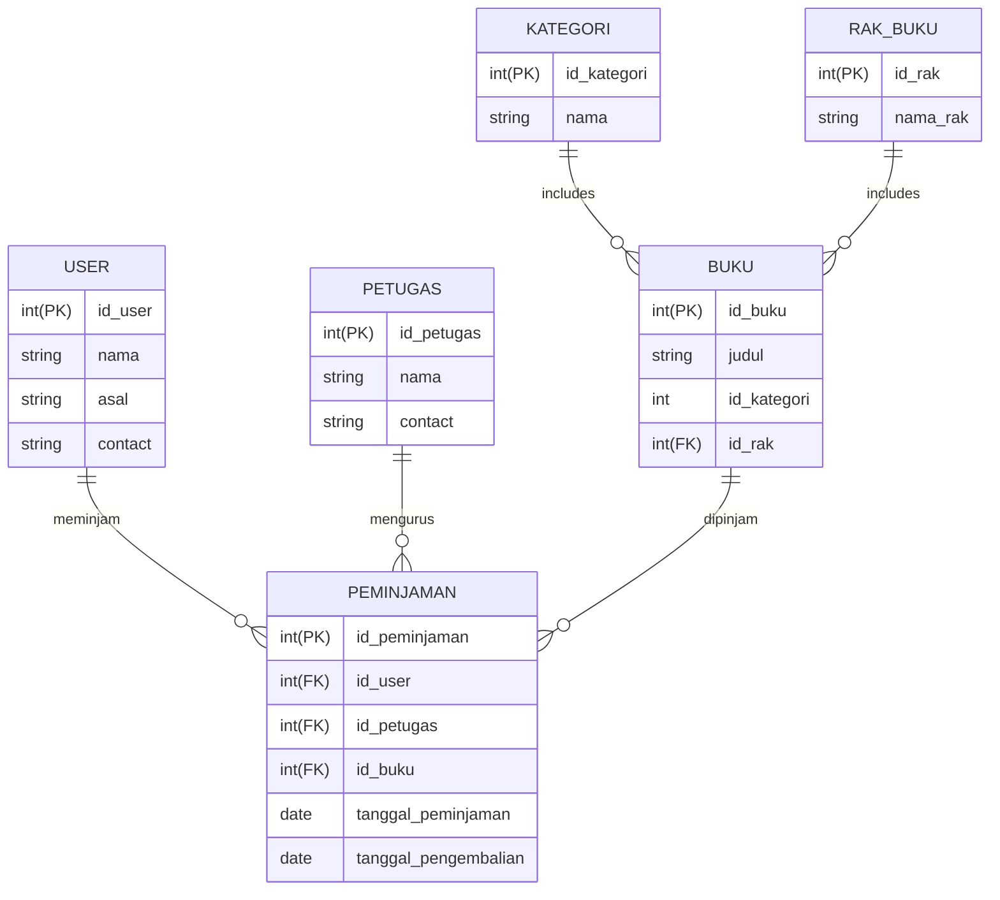

# Database

## Sistem Perpustakaan

Entitas : User

- id_user = id (PK)
- nama = string
- asal = string

Entitas : Buku

- id_buku = id (PK)
- judul = string
- id_kategori = (FK)
- id_rak = (FK)

Entitas : Kategori

- id_kategori = id (PK)
- nama = string

Entitas : rak_buku

- id_rak = id (PK)
- nama_rak = string

Entitas : Petugas

- id_petugas = id (PK)
- nama = string

Entitas : Peminjaman

- id_user = (FK)
- id_buku = (FK)
- id_petugas = (FK)

## diagram

